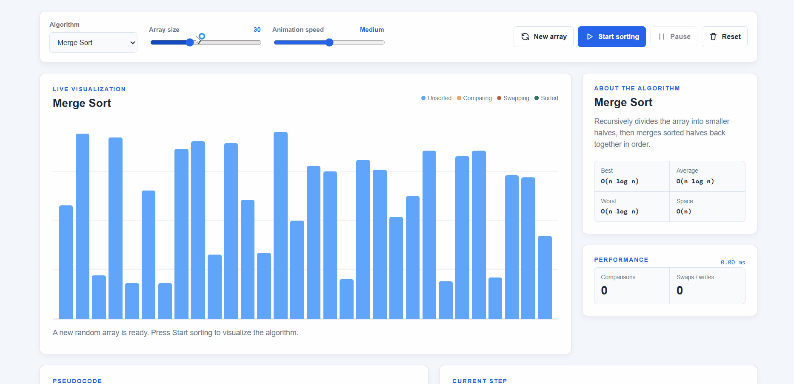

# SortLab - Sorting Visualizer

SortLab is a dependency-free, interactive web application for watching common sorting algorithms work step by step. It animates comparisons, swaps, and writes on a randomly generated array while showing live statistics, complexity information, pseudocode, and contextual explanations.

## Demo



## Features

- Visualizes Bubble, Selection, Insertion, Merge, Quick, and Heap Sort
- Generates random arrays from 8 to 72 values
- Adjustable animation speed, from **Very slow** to **Very fast**
- Pause and resume an in-progress animation
- Reset the original array or generate a new one at any time
- Highlights unsorted, comparing, swapping, and sorted values with a color legend
- Tracks comparisons, swaps/writes, and elapsed sorting time
- Shows algorithm descriptions, best/average/worst/space complexity, and pseudocode
- Includes responsive tablet/mobile layouts and an accessible control interface
- Offers light and dark themes; the selected theme is saved in `localStorage`

## Algorithms

| Algorithm | Best | Average | Worst | Space |
| --- | --- | --- | --- | --- |
| Bubble Sort | O(n) | O(n^2) | O(n^2) | O(1) |
| Selection Sort | O(n^2) | O(n^2) | O(n^2) | O(1) |
| Insertion Sort | O(n) | O(n^2) | O(n^2) | O(1) |
| Merge Sort | O(n log n) | O(n log n) | O(n log n) | O(n) |
| Quick Sort | O(n log n) | O(n log n) | O(n^2) | O(log n) |
| Heap Sort | O(n log n) | O(n log n) | O(n log n) | O(1) |

## Run locally

No installation or build process is required. Because the app uses JavaScript modules, serve the project directory over HTTP instead of opening the HTML file directly.

```powershell
# From the project directory
python -m http.server 8000
```

Then open [http://localhost:8000/sort.html](http://localhost:8000/sort.html) in a modern browser. You can use any other static-file server if you prefer.

## How to use

1. Select an algorithm.
2. Set the array size and animation speed.
3. Choose **Start sorting** to begin the visualization.
4. Use **Pause** / **Resume** to inspect a step, **Reset** to restore the starting values, or **New array** to generate fresh values.
5. Hover a bar on larger screens to view its numeric value. Toggle the theme from the button in the header.

## Project structure

```text
.
|-- sort.html                 # Application markup and controls
|-- sort.css                  # Responsive light/dark interface styles
|-- main.js                   # UI state, events, and visualization lifecycle
|-- algorithms/
|   |-- index.js              # Algorithm metadata and registry
|   |-- BubbleSort.js
|   |-- SelectionSort.js
|   |-- InsertionSort.js
|   |-- MergeSort.js
|   |-- QuickSort.js
|   `-- HeapSort.js
`-- services/
    |-- ArrayRenderer.js      # Bar rendering and visual states
    |-- SortingOperations.js  # Shared animated compare/swap/write operations
    |-- Statistics.js         # Live performance counters
    `-- ThemeManager.js       # Theme persistence and toggling
```

## Implementation notes

Each algorithm receives the same asynchronous operations interface. This keeps sorting logic focused on the algorithm while `SortingOperations` handles animation delay, pause/cancel behavior, DOM updates, color states, and counter updates. The app is written in vanilla HTML, CSS, and ES modules with no third-party runtime dependencies.

## Browser support

Use a current version of Chrome, Edge, Firefox, or Safari with JavaScript enabled.
